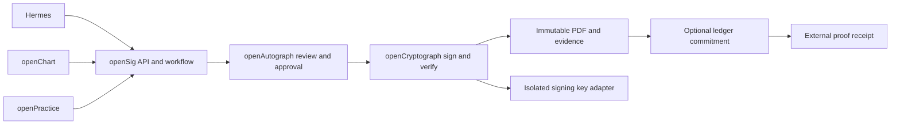

# openSig Overview — Brainstorm

Status: brainstorm
Kind: reference
Summary: openSig combines openAutograph approval and openCryptograph PDF protection under Apache-2.0 with optional blockchain anchoring.
Topics: opensig, document-signing, hermes, openchart, openpractice
Repository context: openSig; shared corporate and healthcare signing
Captured: 2026-11-08

## Possible feats

- **Unified signing platform** — prepare, approve, protect, verify and optionally anchor documents across three consumers.

## Motivation and decisions

FarHeap needs a reusable signing capability for corporate documents that also serves Hermes, openChart and openPractice. The user selected openSig, openAutograph and openCryptograph, all original work Apache-2.0, with MIT/Apache-only third-party components and optional blockchain anchoring.

The names and license intent are agreed. Architecture and implementation sequence remain a captured non-normative proposal. No signing runtime, adapter deployment or ledger transaction is created by this packet.

## Goals

An authorized person reviews an exact document, explicitly approves it, sees their visible signature and obtains an independently verifiable protected PDF. Consumers preserve domain ownership. Optional ledger proof works without disclosing document contents or blocking ordinary signing.

## Non-goals

No automatic personal-signature impersonation, legal notarization, on-chain documents, universal legal-validity guarantee or transfer of clinical/financial authority. Do not rebuild cryptographic primitives or fork copyleft signing platforms.

## What the system delivers

- **openSig:** envelopes, templates, identities/permissions, audit evidence, API and integrations.
- **openAutograph:** review, consent, authenticated approval and visible signature/initial/date fields.
- **openCryptograph:** certificate signatures, organizational seals, timestamps and revision-aware verification.
- **Optional anchoring:** private commitments/proofs and interchangeable ledger adapters.

## System model

The autograph is an appearance; approval records a person's action; a certificate protects PDF revisions; a ledger records commitment inclusion. Each is a separate claim.

## Cluster map and system fit

- [Trust evidence synthesis](opensig-synthesis-trust.md) connects human approval, cryptographic protection and external proof.
- [Shared platform synthesis](opensig-synthesis-platform.md) connects licenses, consumer authority and delivery dependencies.

Prefer an independent API service with Frappe-native adapters. Inspected openChart has its intake application foundation; openPractice currently has governance tooling and a planned app. No consumer source was modified. Core framework and full deployment license compatibility remain qualification tasks.

## Implementation and open decisions

Follow the [implementation plan](opensig-implementation-plan.md): foundation/engine qualification, workflow/approval, cryptographic finalization, Hermes pilot, openChart and openPractice adapters, optional anchoring and release operations. Resolve repository owner, runtime, engine, certificate/TSA, authentication and retention in phase 0. No blockchain network is chosen. Public naming availability is unchecked.

## Complete document map

Synthesis documents:

- [Trust evidence](opensig-synthesis-trust.md)
- [Shared platform](opensig-synthesis-platform.md)

Atomic documents:

- [Licensing and boundaries](opensig-licensing.md)
- [Human approval and PDF signature evidence](opensig-signing-evidence.md)
- [Envelope workflow and consumer contracts](opensig-workflow-adapters.md)
- [Optional anchoring](opensig-anchoring.md)
- [Implementation plan](opensig-implementation-plan.md)
